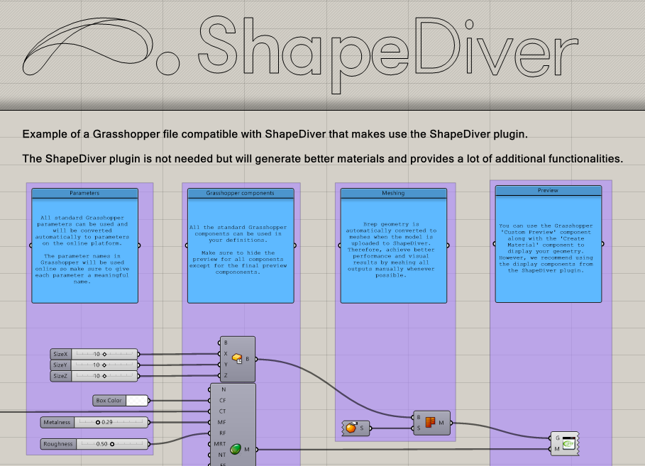

Learn how to turn Grasshopper definitions into web applications

<h1>Welcome to the ShapeDiver tutorial library</h1>

Grasshopper definitions that demonstrate ShapeDiver features. Each one is a tutorial, kept current with the plugin, and ready to upload as an online application. See <a href="https://shapediver.com/">what ShapeDiver is</a>, <a href="https://www.shapediver.com/app/register">create an account</a>, <a href="https://www.food4rhino.com/en/app/shapediver">download the Grasshopper plugin</a>, or <a href="https://www.shapediver.com/app/m/upload">start uploading</a> definitions.

## Get started

Each definition walks through the steps for one plugin feature. Open a section, read what the example covers, and use the level marker to judge the difficulty. You can upload the definitions as they are, or treat them as a starting point for your own designs.

★☆☆ Beginner
★★☆ Intermediate
★★★ Expert

## Categories

<a href="01-Basics/definitions.html">Basics</a>
<a href="02-Inputs/definitions.html">Inputs</a>
<a href="03-Outputs/definitions.html">Outputs</a>
<a href="04-Display/definitions.html">Display</a>
<a href="05-Images/definitions.html">Images</a>
<a href="06-JSON/definitions.html">JSON</a>
<a href="07-Attributes/definitions.html">Attributes</a>
<a href="08-Plugins/definitions.html">Plugins</a>
<a href="11-AppBuilder/definitions.html">App Builder</a>
<a href="12-DesktopClients/definitions.html">Desktop Clients</a>
<a href="Showcases/definitions.html">Showcases</a>
<a href="BETA/definitions.html">BETA</a>

